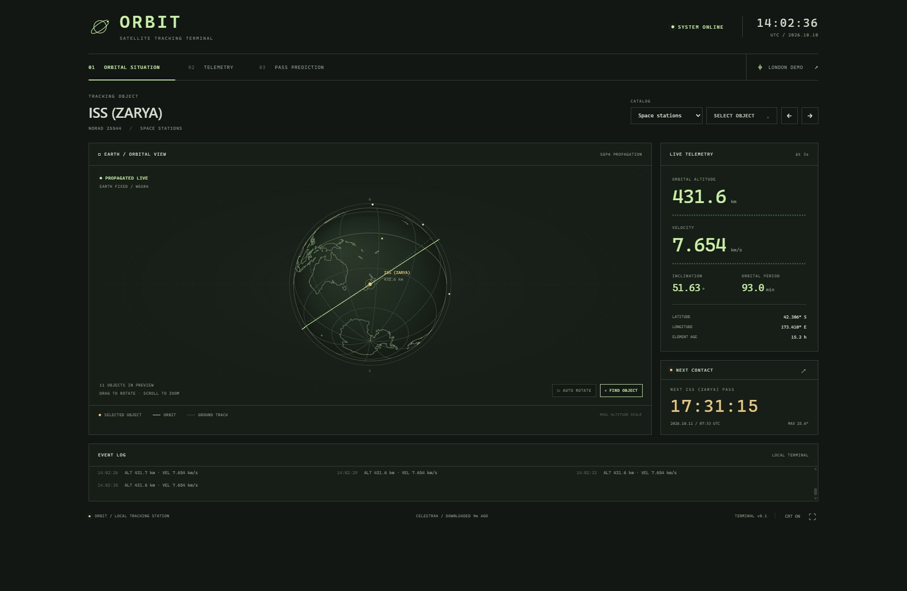

# ORBIT / Retro Satellite Tracking Terminal

A local PC satellite terminal with a phosphor-green globe, orbital telemetry and ground-station pass predictions. Python calculates orbits from **CelesTrak GP orbital elements**; a browser draws the terminal. The versioned JSON API can support an ESP32 display later.



## Run on your PC

Uses Python **3.14** and [uv](https://docs.astral.sh/uv/getting-started/installation/), plus a modern browser and internet access for the first catalog download. No Node.js, API key, external fonts or frontend build step is required.

Install uv using the linked instructions, then run these commands from the repository root on Linux, macOS, WSL or Windows PowerShell:

```sh
uv sync --locked
uv run --locked run.py
```

uv uses `.python-version` to select Python 3.14, downloads it if needed, and creates the local `.venv` with dependencies from the committed `uv.lock`. Project metadata and development dependencies live in the root `pyproject.toml`; no manual environment activation is needed. If migrating from the earlier Python 3.11/3.12 setup, stop the running server before syncing; uv recreates the project environment for Python 3.14.

Open **http://127.0.0.1:8000** if your browser does not open automatically. For WSL, use `uv run --locked run.py --no-browser` and open that address in your Windows browser. Stop with Ctrl+C. Use `--port 8080` if port 8000 is busy.

Select **Set ground station** and enter your name, latitude, longitude and elevation. The app starts with the ISS and leaves coordinates unset until saved. Coordinates stay in the local data directory and are never sent to CelesTrak.

## Three displays

- **01 / Orbital situation:** rotating Earth with bundled coastlines, grid, actual-altitude orbit, spacecraft markers, telemetry, next-pass countdown and a compact scrolling event log. The separate ground-track map is omitted to suit the eventual embedded display. Drag to rotate, scroll to zoom, or select **Find object**.
- **02 / Telemetry:** altitude, inertial velocity, mean inclination, period, latitude/longitude, eccentricity, estimated mean orbital phase and observer look angles. Charts accumulate real samples during the current session.
- **03 / Pass prediction:** 48-hour forecast with rise, culmination and set, maximum elevation, compass directions, duration and a polar sky plot. Select a row to inspect its path; choose an elevation mask from 0 to 30 degrees.

The catalog selector offers **47 CelesTrak groups**, organized into seven sections:

- **Popular & recent:** space stations, brightest objects, active satellites, recent launches and analyst satellites.
- **Weather & Earth observation:** weather, Earth resources, radar imaging, search/rescue, disaster monitoring, TDRSS, ARGOS, Planet and Spire.
- **Communications:** Starlink, OneWeb, Kuiper, Qianfan, Hulianwang Digui, geosynchronous satellites, Intelsat, SES, Eutelsat, Telesat, Iridium NEXT, Orbcomm, Globalstar, amateur radio, SatNOGS and experimental/other communications.
- **Navigation:** GNSS, operational GPS/GLONASS, Galileo, BeiDou and augmentation systems.
- **Science & education:** space/Earth science, geodetic, engineering, education and CubeSats.
- **Military & calibration:** military and radar calibration.
- **Debris:** Fengyun 1C, Iridium 33 and Cosmos 2251 debris.

Categories use [CelesTrak's published GP groups](https://celestrak.org/NORAD/elements/), so membership can differ from N2YO's categories. Groups can overlap and some include rocket bodies or debris. A group downloads only when requested; listing categories does not fetch every catalog. The browser builds its selector from `/api/v1/status` group IDs, names and category sections.

Search by name or NORAD ID and load more results. The globe shows up to 12 representative objects including the selection. OMM JSON supports six-digit and larger catalog IDs.

Keyboard: **1 / 2 / 3** switch pages; **left / right arrows** cycle listed objects. CRT texture and fullscreen are optional. Reduced-motion preferences disable automatic rotation. The layout adapts to narrower displays.

## Data and prediction behaviour

Positions are **SGP4 predictions for current UTC**, not measurements streamed from spacecraft. Telemetry refreshes every three seconds; paths and forecasts refresh every minute. Element age and catalog download age are shown separately. Elements more than seven days from their epoch and telemetry that stops updating trigger warnings.

CelesTrak is queried with `https://celestrak.org/NORAD/elements/gp.php?GROUP=stations&FORMAT=JSON`. Groups download lazily and are cached for two hours. Failed attempts also trigger a persisted two-hour cooldown to prevent repeated requests on errors. Cached data remains available with a warning. With no successful download, the app shows an unavailable state and never substitutes simulated or fixture data.

Passes are **geometric** opportunities above the elevation mask. Sunlight, local darkness, terrain, refraction, clouds and optical visibility are not evaluated. Ongoing passes retain their actual rise time. A continuously above-mask object may have no complete rise-to-set window. This is a hobby display, not spacecraft navigation data.

Altitude is WGS84 ellipsoid height; speed is geocentric inertial velocity magnitude. Inclination and period come from mean elements. Estimated mean phase advances epoch mean anomaly using mean motion. Orbit samples use the Earth frame frozen at the track timestamp; ground-track samples account for Earth rotation at each timestamp.

## Architecture

```text
retro-sat-track/
├── run.py
├── pyproject.toml             # Project metadata and dependencies
├── uv.lock                    # Reproducible dependency versions
├── .python-version            # Python 3.14
├── backend/
│   ├── app/
│   │   ├── main.py            # FastAPI and saved observer
│   │   ├── models.py
│   │   ├── tracking/
│   │   │   ├── catalog.py     # CelesTrak, disk cache and cooldowns
│   │   │   ├── propagation.py # SGP4, state and paths
│   │   │   └── visibility.py  # Geometric passes and sky paths
│   │   └── static/            # Browser UI and bundled basemap
│   └── tests/                 # Offline regression checks
└── .github/workflows/ci.yml
```

Runtime files live in ignored `.data/`; override with `SAT_TRACK_DATA_DIR`. This MVP runs on your PC. The next hardware phase is drafted in [hardware/README.md](hardware/README.md): bill of materials, Fusion CAD generator and [ESP32 firmware design](firmware/README.md). Revision E provides editable Fusion CAD for the Adafruit 2050 3.5-inch landscape display, a separate ESP32-S3 and rechargeable PowerBoost supply. Its telemetry/backlight/low-battery firmware compiles; physical fit and electrical testing, encoder navigation, globe and pass pages remain pending.

## API for a future ESP client

Interactive docs: **http://127.0.0.1:8000/docs**. Fields include units in their names; UTC timestamps are ISO 8601. Satellite endpoints default to `group=stations`; use IDs such as `starlink`, `weather`, `amateur`, `cubesat` or `galileo` as needed. `GET /api/v1/status` lists every supported group with its name and category section.

| Endpoint | Purpose |
| --- | --- |
| `GET /api/v1/status` | Health, UTC, saved observer, catalog freshness and errors |
| `GET /api/v1/satellites?group=stations&q=ISS&limit=150&offset=0` | Searchable, paginated catalog |
| `GET /api/v1/satellites/25544/state` | Current orbit, geography and observer look angles |
| `GET /api/v1/satellites/25544/track?samples=180` | Orbit vectors in Earth-fixed kilometres and timed ground track |
| `GET /api/v1/scene?selected_id=25544&limit=12` | Bounded set of current states for the globe |
| `GET /api/v1/passes?satellite_id=25544&hours=48&min_elevation=10` | Passes for the saved observer |
| `GET /api/v1/passes?satellite_id=25544&lat=51.5&lon=-0.12&elevation_m=0` | Passes for explicit coordinates without saving |
| `GET /api/v1/passes/{id}` | Detailed events and sky path; request the list first |
| `POST /api/v1/observer` | Save the observer locally |

Observer body:

```json
{"name":"Home station","latitude_deg":51.5,"longitude_deg":-0.12,"elevation_m":0}
```

Pass IDs belong to the in-memory forecast cache; request the list again after restart. The server binds to loopback by default. For a later ESP experiment, `uv run --locked run.py --host 0.0.0.0 --no-browser` exposes the service on your LAN. The MVP has no API authentication and should not be exposed to the public internet.

## Checks

Format Python code and sort imports with Black and Ruff:

```sh
uv sync --locked --dev
uv run --locked ruff check --fix .
uv run --locked black .
```

Run the same formatting, lint, type and backend checks as CI:

```sh
uv sync --locked --dev
uv run --locked black --check --diff .
uv run --locked ruff check .
uv run --locked pyright
uv run --locked pytest -q
```

Offline checks cover published Skyfield position and pass examples, altitude/speed bounds, orbit versus ground-track coordinates, ongoing passes, persistent cache/cooldown behaviour, API responses, observer validation/persistence and extended catalog IDs. Black handles formatting; Ruff checks Python errors, import ordering and missing parameter/return annotations. Black and Ruff use Python 3.14 and an 88-character line length. Pyright checks the application, test helpers and local Skyfield stubs in standard mode. CI installs Python 3.14 and uses uv with the committed lockfile. Run the checks from the repository root.

## Editor type checking

Pyright's language server and command-line check share `[tool.pyright]` in `pyproject.toml`: Python 3.14, the `backend` import path, the uv `.venv` and local stubs in `typings/`. Build outputs are excluded. See [Pyright configuration](https://github.com/microsoft/pyright/blob/main/docs/configuration.md).

For an editor using the Pyright LSP, launch this command from the repository root:

```sh
uv run --locked pyright-langserver --stdio
```

Configure that command in your editor's Python language-server settings. For VS Code/Pylance, open this WSL project through WSL and select `.venv/bin/python` as the Python interpreter; Pylance uses the selected interpreter rather than Pyright's `venv` setting. Reload the language server if it was already running with the old configuration.

The partial Skyfield stubs describe the numerical properties and scalar/array results used here, without changing runtime calculations. See `typings/README.md` for their scope.

## Attribution

- [CelesTrak GP documentation and request policy](https://celestrak.org/NORAD/documentation/gp-data-formats.php).
- [Skyfield satellite calculations](https://rhodesmill.org/skyfield/earth-satellites.html), using SGP4.
- Bundled [Natural Earth 1:110m land](https://github.com/nvkelso/natural-earth-vector/blob/master/geojson/ne_110m_land.geojson) is [public domain](https://www.naturalearthdata.com/about/terms-of-use/).
- Retro inspiration: [trehn/termtrack](https://github.com/trehn/termtrack). This implementation uses its own interface and rendering code.
