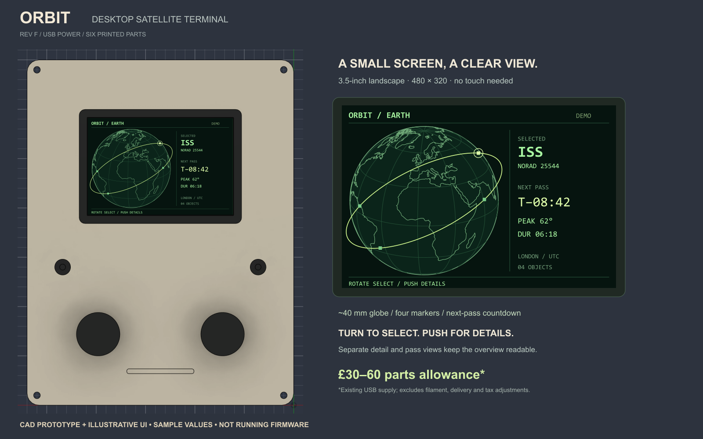
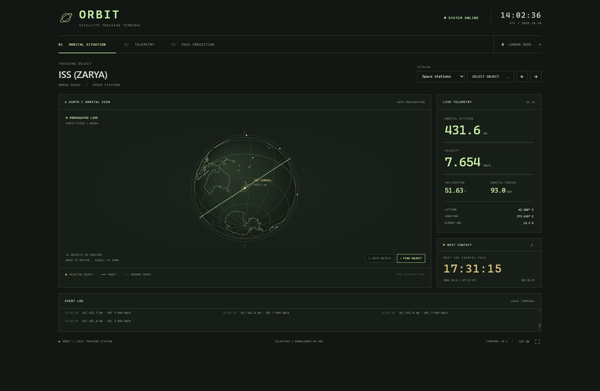

# ORBIT / Retro Satellite Tracker

A working green-screen satellite tracker for your PC, plus a Macintosh-inspired **USB tabletop terminal design**.

[**AliExpress BOM**](hardware/BOM.md) · [**Fusion / STEP / STL**](hardware/cad/generated-revf/) · [**Build guide**](hardware/ASSEMBLY.md) · [**PC app & API**](docs/PC-GUIDE.md)



**Rev F:** no-touch 3.5-inch 480×320 MSP3525/ST7796U display, ESP32-S3 N8R8, push encoder, brightness knob and two toggles. **£30–60 parts allowance** using an existing USB supply; filament, delivery and checkout tax adjustments are extra. AliExpress prices/UK stock and physical fit remain unverified.

| Works today | Designed / planned |
| --- | --- |
| PC globe, telemetry, catalogue search and geometric pass predictions | Six-part printable enclosure, electronics layout and wiring plan |
| CelesTrak/SGP4 backend with a versioned JSON API | ST7796U display port, encoder navigation and the embedded UI shown above |

The checked-in ESP firmware is the **legacy Adafruit HX8357D telemetry starter**, not the screen concept. [Firmware status](firmware/README.md) · [Three-view UI concept](hardware/UI-CONCEPT.md) · [Historical rechargeable build](hardware/revisions/reve/README.md).

## Run the PC app

Install [uv](https://docs.astral.sh/uv/getting-started/installation/), then from the repository root:

```sh
uv sync --locked
uv run --locked run.py
```

Open **http://127.0.0.1:8000**. Uses Python 3.14; set your ground station in the UI. [Setup, controls, API, data behaviour and development checks](docs/PC-GUIDE.md).



Positions are predictions from orbital elements, not spacecraft measurements; passes are geometric opportunities, not guaranteed optical visibility. [Sources and attribution](docs/PC-GUIDE.md#attribution).
