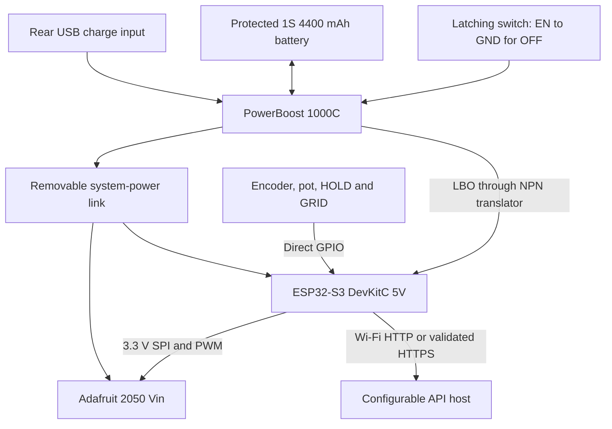

# ORBIT revision E — electronics integration and build

Rev E uses the Adafruit 2050 landscape TFT, an ESP32-S3-DevKitC-1 N8R8 and PowerBoost 1000C. The enclosed body stays **135×175×95 mm**, with bezel and controls projecting beyond it. [BOM](BOM.md) · [Battery/power wiring](BATTERY.md) · [Firmware](../firmware/README.md).

## What the tray is for

The plate previously shown to the left is a **removable internal electronics tray**, not an external accessory. It is installed in the lower half of the shell. Its 110×70 mm plate carries a socketed ESP32 perfboard carrier and the charger on 6 mm nylon spacers. Four M3 screws secure it to integral shell ledges. It can be unplugged and removed through the rear for servicing.

The screen attaches directly to four front-panel bosses through its PCB mounting tabs; the old square-screen retainer is removed. Knobs and toggle switches mount with their own panel nuts. The battery cradle attaches to the rear cover above the tray. Both enclosure sides remain solid; only the separate inspection archive hides the shell and rear cover.

## CAD dimensions and evidence

Coordinates are millimetres: X left/right, Y bottom/top, Z front/rear. Front is Z0–3, shell Z3–92, rear Z92–95.

| Item | Position / dimensions | Evidence / remaining fit check |
| --- | --- | --- |
| TFT PCB including mounting tabs | X16.29–112.81, Y87.98–154.02, Z7.8–9.4; 96.52×66.04 mm landscape | XY from Adafruit Eagle board; simplified tab outline, nominal thickness |
| TFT mounting centres | X18.83 /110.27, Y90.52 /151.48; 91.44×60.96 mm spacing | Published 3 mm holes; use M2.5 fixings |
| Glass / active area | 84.7×54.34 /72.82×48.96 mm; active centre (67.5,121) | Eagle TFT package; 4 mm glass-stack depth provisional |
| Front aperture | X30.7, Y96.1; 73.6×49.8 mm | Clears published active area; verify actual screen alignment |
| Tray | X12.5–122.5, Y10–80, Z55–58 | Four shell supports and M3 insert pilots |
| Carrier | X26–59, Y12–73, Z64–65.6; 33×61 mm | Drill holes at X29/56, Y16/57; socket row fit to actual DevKit |
| ESP32 | Nominal 25.4×62.5 mm at X29.8, Y13, Z73 | Simplified envelope, verify purchased board, USB exits and antenna |
| PowerBoost | 36.068×22.86 mm at X70, Y23, Z64 | Manufacturer PCB without optional USB-A; holes (72.54,25.54), (72.54,43.32) |
| Battery cradle / pack | 85×51×24 /69×37×18 mm | See BATTERY.md for coordinates and retention |
| USB adapter | 49×26×2 mm, 16×9 mm opening, 24 mm flange pitch | Generic replaceable plate; match extension before printing |

The TFT product listing's 97×56 mm size omits the mounting-tab width; this model includes the tabs. Landscape mapping from the source board is X=59.47+EagleY, Y=121+EagleX. Sources: [Adafruit TFT PCB](https://github.com/adafruit/3.5inch-TFT-Breakout-PCB), [PowerBoost PCB](https://github.com/adafruit/Adafruit-PowerBoost-1000C). Dimensions were checked against the source boards on 2026-10-13. Electronics are reference envelopes, not detailed manufacturer STEP models.

The carrier has a central antenna cutout at X33–52/Y63–73, aligned above the tray opening at X25–59/Y63–77. Socket rails remain along the sides; confirm clearance against the actual module. Keep metal, wires and fasteners away from the actual antenna. Cable shapes reserve routes only; they do not specify connector placement, bend radii or lengths.

## Connections

| Signal | ESP32 GPIO / wiring |
| --- | --- |
| TFT CLK / MOSI / MISO | 12 /11 /13 |
| TFT CS / D-C / RST | 10 /9 /14 |
| TFT LITE | 15, 5 kHz backlight PWM |
| TFT Vin / GND | System 5 V rail / common GND; leave 3Vo as output, not an ESP supply |
| TFT IM2 | Close the rear IM2 solder jumper to 3.3 V to select SPI |
| TFT CCS (SD chip select) | 10 kΩ to TFT 3Vo; SD unused, keep deselected |
| TFT touch pins / other unused bus pins | Unconnected; no touchscreen driver in this build |
| Encoder A / B / push | 4 /5 /6 reserved, common contacts to GND, pull-ups when implemented |
| B10K pot | Wiper to 1 (ADC1), ends ESP 3V3/GND, 100 nF wiper-to-GND |
| HOLD / GRID switches | 7 /8, close to GND; firmware enables pull-ups |
| Low-battery warning | 2, from NPN collector only; circuit in BATTERY.md |

Use 3.3 V logic and common ground throughout. Avoid ESP32 boot straps (0/3/45/46), USB 19/20 and flash/PSRAM 26–37. Keep SPI wiring short, ground adjacent, and label detachable harnesses. Follow the [Adafruit SPI setup](https://learn.adafruit.com/adafruit-3-5-color-320x480-tft-touchscreen-breakout/spi-wiring-and-test) and [pinout](https://learn.adafruit.com/adafruit-3-5-color-320x480-tft-touchscreen-breakout/pinouts).

## Build sequence

1. **Measure purchased parts.** Confirm TFT hole centres, glass-to-PCB stack, header protrusion, DevKit socket spacing, controls, charger connectors and USB extension. Print a small display/insert fit coupon before the full front. The 4.8 mm display bosses must support the PCB without pressing glass onto the front panel.
2. **Bench-test display and controls.** Set IM2, wire SPI and PWM, compile/upload the firmware and verify green telemetry, brightness, HOLD and detail toggle. Initially power through the DevKit USB with the boost output link disconnected. Encoder selection is not yet implemented.
3. **Print seven parts.** Ivory front/shell/rear; charcoal bezel/tray/USB adapter/battery cradle. P1S starting settings: 0.4 mm nozzle, 0.2 mm layers, four walls, 15% gyroid. Orient each STL and drop to bed; exports retain assembly coordinates. Inspect supports under tray ledges. Print cradle backplate on bed, guards up; smooth all pack-facing edges.
4. **Fit inserts before electronics.** Four M3 inserts in shell tray supports and four M2.5 in front display bosses. Calibrate the 4.4/3.3 mm pilot diameters to the actual inserts. Do not heat inserts with the battery or screen fitted.
5. **Assemble front panel.** Fit bezel pegs and bond after checking alignment. Install controls with nuts/washers and purchased knobs. Seat the TFT PCB on its four bosses and secure with M2.5×5 screws and thin nylon washers. Check screw depth and tighten gently; no screw or clamping load on glass.
6. **Build tray.** Trim/drill perfboard, cut the antenna clearance, then solder socket headers and the low-battery translator. Verify header pin numbering and cut unwanted copper connections on stripboard. Mount carrier and PowerBoost with six 6 mm spacers and M2.5×16 fixings. Omit PowerBoost's optional USB-A connector; solder a detachable output lead. Socket the ESP32 with its antenna beyond the carrier.
7. **Install front and tray.** Fit front to shell with four M3 through-boss fixings; secure tray with four M3×10 screws. Connect SPI/controls and power with service slack. Keep harnesses clear of the antenna, mounting holes and the rear battery cradle.
8. **Assemble rear.** Fit USB extension and its replaceable adapter, latching power button, battery cradle and soft strap/pad. Wire charger, switch and battery as in BATTERY.md. The battery and switch move with the cover: provide detachable leads and strain relief.
9. **Commission while open.** Check polarity, rails, translated LBO levels, charge current, operation from USB/battery and off-state charging. Measure temperatures and low-charge battery current. For PC programming, disconnect the boost output link first; do not parallel PC USB with PowerBoost output.
10. **Close and test fit.** Verify wire clearance, screw lengths and pack retention; fit rear screws and feet. Repeat thermal checks with the enclosure closed before unattended operation. Opening four rear screws gives service access without removing the front controls.

## Validation limits

Fusion feature health, rigid-envelope interference and STL edge/manifold checks are recorded with the exports. They establish geometric consistency of this model, not purchased-part fit, electrical operation, cooling or battery runtime. Flexible cable/strap references are excluded from rigid interference checks. The assembled archive retains the full enclosure; the inspection archive hides only `02 Ivory shell` and `03 Ivory rear cover`.
