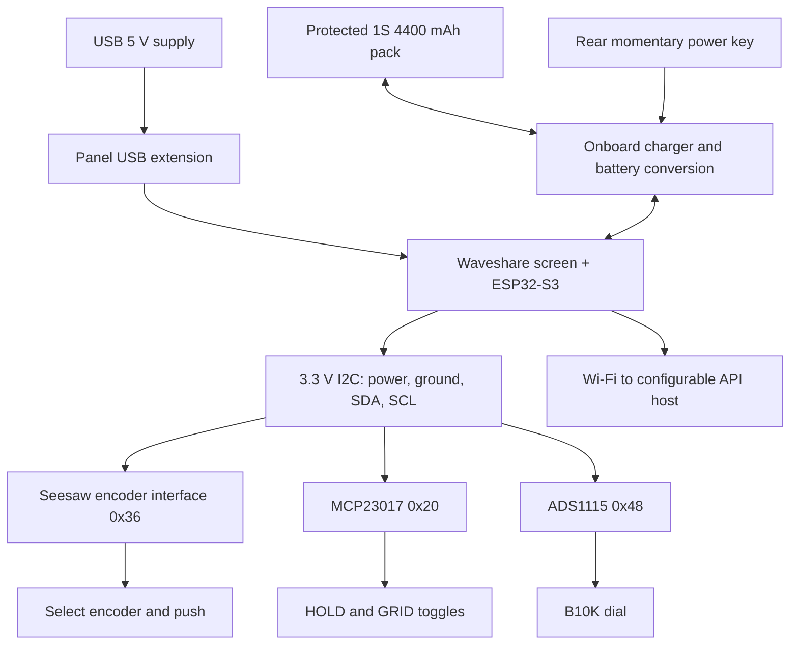

# ORBIT revision D — electronics integration and build

Revision D retains the Rev C controls and adds rechargeable power. See [battery integration](BATTERY.md) for the cradle, revised rear panel, required charger-current change and commissioning sequence.

## What the loose tray was for

The plate previously displayed to the left was an uninstalled control-electronics carrier, not an external accessory or keyboard. It is now a **110×70 mm removable internal tray**, below the display and 55 mm behind the front plane. It carries the MCP23017 switch interface, ADS1115 dial interface and a small detachable wiring terminal/perfboard. Four M3 screws fasten it to supports integrated into the shell. Remove the rear cover to unplug and remove it for servicing.

## What is now modelled in Fusion

- Waveshare display/controller PCB behind the square screen, plus illustrative component, connector and antenna clearances.
- Seesaw encoder PCB directly behind the SELECT encoder, with the encoder body; a pot body and both toggle bodies behind the panel.
- MCP23017, ADS1115 and terminal board on 6 mm nylon spacers behind the removable tray.
- Four tray ledges in the shell, M3 screw/insert envelopes and eight insert locations across tray/display supports.
- A rear display retaining frame, PCB-edge seating/pressure pads and gasket clearance. Screws bear on the frame, never directly on the active glass.
- Replaceable rear USB adapter plate with a generic 16×9 mm port cutout and 24 mm extension-flange screw pitch. Match this replaceable part to the extension you buy.
- Blue I²C and orange USB cable route envelopes. They show reserved routes, not literal rectangular wires, connectors, final lengths or bend radii.

The manufacturer-reported outlines are used for the Adafruit boards: seesaw 25.6×25.3, MCP23017 43×18, ADS1115 25.4×17.8 mm. Waveshare reports 76.54×74.66 mm for the non-touch module. PCB thickness, component shapes/locations, antenna location, control bodies, mounting centres and USB connector are **simplified engineering envelopes**, not imported manufacturer STEP models. Fit must be confirmed against the actual parts. The display reference does not imply a separate ESP32: its controller is built in.

## Physical arrangement

Looking in from the rear: the large square assembly at the top is the Waveshare board and retaining frame. The tray occupies the lower half. The pot, encoder and toggles are forward of the tray; their shafts pass through the front panel and are fixed with their supplied nuts/washers. The seesaw board is soldered to the compatible encoder behind the front, so it is not a third board on the tray. The MCP/ADC boards face the removable rear cover for access to their connectors.

Shell depth runs from Z3 to Z92. Tray is Z55–58; spacer-mounted boards are near Z64–69, with terminals up to approximately Z74. The rear panel begins at Z92, leaving a cable/service zone. The screen is forward of the tray and is accessible through the retaining frame's rear window. Keep the antenna region free of metal and cable bundles; its true position comes from the purchased board drawing.

## Electrical integration

The shared four-wire I²C harness is 3V3/GND/SDA/SCL. Set and measure the Waveshare terminal's I²C power selector at 3.3 V. Use the schematic/BSP for the purchased revision: V4 uses SDA15/SCL7; earlier revisions differ. Do not connect to the former DevKitC SPI pin table.

Encoder: solder the compatible PEC11-pinout encoder to seesaw 4991, including its push contacts. MCP: GPA0 to HOLD, GPA1 to GRID, both pulled high; each switch closes to ground. ADC: A0 to pot wiper, ends to 3V3/GND, 100 nF wiper-to-ground. USB supplies the Waveshare board, which powers the low-current input interfaces. Use one USB supply and the protected pack on the dedicated battery header. The V4 charger must be configured and measured at the reduced charge current before connecting this pack for USB charging; see BATTERY.md. Do not use external DC input in this configuration.

Route the short control harness along the side corridor with slack at the removable tray. Use detachable plugs and labels at both ends. Keep USB cable slack clear of screw bosses and the antenna. Begin at 100 kHz I²C; verify aggregate pull-ups and board helper operation. The terminal sends selections to its own UI and polls the existing API over Wi-Fi; it does not directly control the web browser.

## Build sequence

1. **Confirm components before printing final mounting parts.** Obtain the Waveshare board revision and drawing, compatible threaded panel encoder, pot, toggles and USB extension. Measure display/glass offset, PCB edges, connector exits and flange pitch. Adapt the retainer depth/pads and USB plate to these measurements. Cut the display/control fit coupon first.
2. **Bench-test electronics.** Run the revision-matched Waveshare example, verify its 3.3 V control power, scan I²C, then read encoder/push, both switches and pot. The old ILI9341 starter is incompatible; the Waveshare firmware port is still required.
3. **Print mechanical parts.** Ivory front, shell and rear; charcoal bezel, tray, retainer and USB adapter. 0.4 mm nozzle, 0.2 mm layers, four walls and 15% gyroid are starting settings. Inspect supports around tray ledges and the front's taller stand-offs. Drop each STL to the bed and orient it; exports retain assembly coordinates.
4. **Install eight M3 heat-set inserts before electronics.** Four shell tray ledges and four front display stand-offs. Model uses 4.4 mm pilot diameter × 5 mm depth for approximately 4.6 mm OD × 5 mm inserts. Print and calibrate an insert coupon to the exact insert supplier before using heat near the finished case. Use M3×10 tray screws and M3×8 retainer screws as starting lengths; verify they do not bottom out.
5. **Assemble the front.** Register/glue the bezel after fit approval. Mount controls with washers/nuts and fit purchased knobs. Seat the display on its PCB-edge supports with a soft gasket, fit the rear retainer and tighten evenly without loading the glass. The current pad/gasket depth assumes the provisional PCB stack; change it to the measured board before printing.
6. **Build the tray outside the enclosure.** Use M2.5×16 screws, nuts/washers and 6 mm nylon spacers for MCP, ADC and perfboard. Slotted mount rows permit adjustment; confirm actual fixing holes and drill/adapt where required. Keep solder joints and metal fasteners clear of the tray and neighbouring traces.
7. **Fit front and tray.** Attach front to shell using its four M3 face screws/nuts. Install tray onto the four shell supports, plug in labelled controls and I²C, and leave enough slack to remove it from the rear.
8. **Fit USB and test while open.** Bolt the USB extension to its adapter with two M2.5 fixings and the adapter to the rear with two M3 fixings. Plug into the Waveshare USB port; ensure the lead is strain-relieved. Verify inputs, Wi-Fi, display and supply stability before fitting the rear.
9. **Add rechargeable power.** Follow BATTERY.md to modify and verify the charger, fit the rear cradle and momentary button, and bench-test battery/USB transitions. Leave detachable service slack: the battery moves with the rear panel.
10. **Close and finish.** Secure the rear panel with four M3 screws/nuts, add rubber feet, and inspect cable clearance. Removing four rear screws gives service access without taking off knobs or switches.

## BOM additions and revised budget

Keep the revision B electronics. Add eight short M3 heat-set inserts, four M3×10 tray screws, four M3×8 retainer screws, two M3×10 USB-plate screws, two M2.5 USB-flange screws, six M2.5×16 board screws/nuts, six 6 mm nylon spacers and a small soft gasket/strain-relief set. Quantities and lengths are prototype selections; confirm the actual board holes and screw engagement. Allow approximately **£135–225 excluding filament/delivery and paid board rework** for the complete parts list. The battery additions are itemised in the current BOM. Purchased knobs and electronics are not printable STLs.

## Validation limits

Fusion feature health and STL manifold/dimension checks are geometric checks. They do not validate physical fit, wire lengths, board-mount hole accuracy, connector pin order, electrical safety or an operating firmware build. Reference electronics and route envelopes intentionally simplify details. Rev D adds battery/cradle/power-button interference checks against the simplified assembly. An assembled F3D and an inspection F3D with shell/rear hidden are included. Unhide `02 Ivory shell` and `03 Ivory rear cover` in Fusion to see the exterior again.

Sources: [Waveshare module](https://www.waveshare.com/product/mcu-tools/esp32-s3-touch-lcd-4.htm), [board revision reference](https://github.com/waveshareteam/ESP32-S3-Touch-LCD-4/blob/main/hardware/HARDWARE_REFERENCE.md), [seesaw dimensions](https://www.adafruit.com/product/4991), [MCP dimensions](https://www.adafruit.com/product/5346), [ADC dimensions](https://www.adafruit.com/product/1085).
