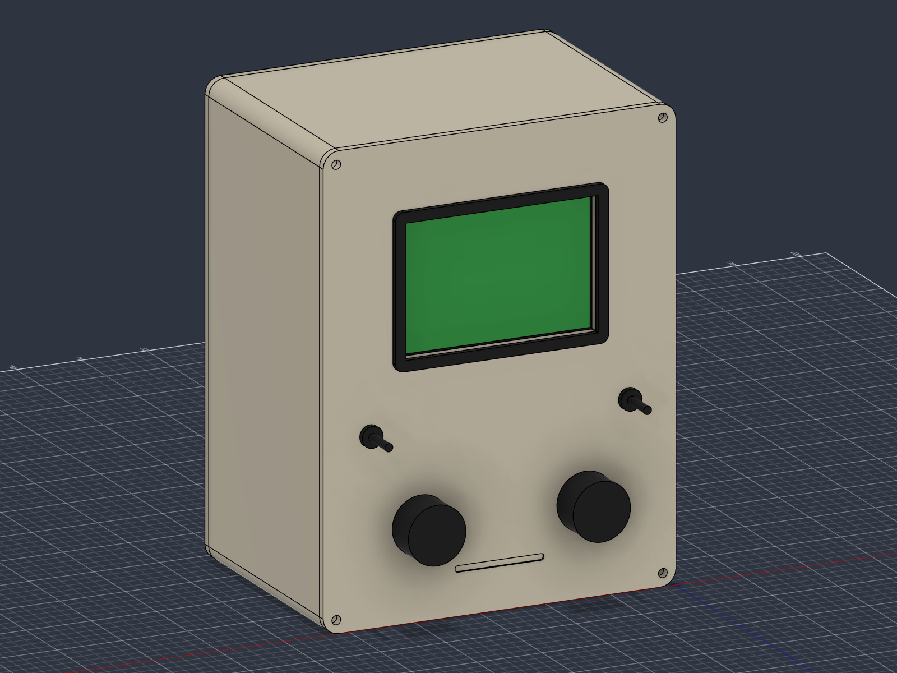
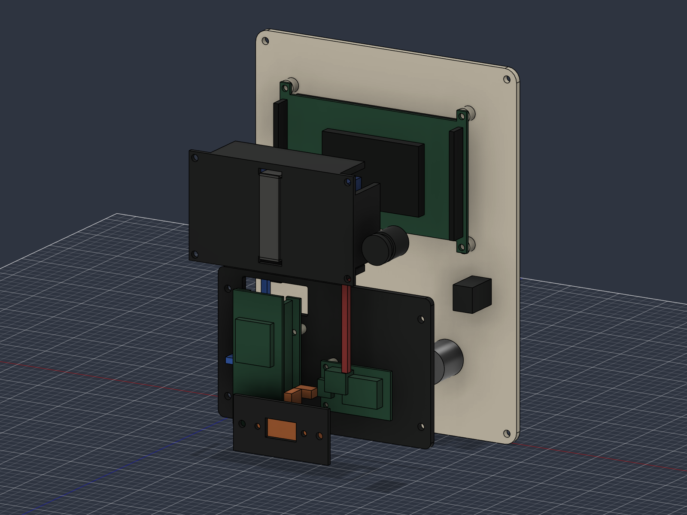

# ORBIT tabletop terminal — revision E

A Macintosh-inspired **3.5-inch landscape green-screen terminal**, with two knobs, two metal toggles and rechargeable power. The case is **135 mm wide ×175 mm high ×95 mm deep**; bezel and controls project beyond that envelope.

- [Bill of materials and PLA colours](BOM.md)
- [Assembly, mounting dimensions and GPIO wiring](ASSEMBLY.md)
- [Battery, charging and programming-power procedure](BATTERY.md)
- [Editable complete Fusion assembly](cad/generated-reve/ORBIT-RevE.f3d)
- [Internal inspection assembly](cad/generated-reve/ORBIT-RevE-inspection.f3d)
- [STEP assembly, seven printable STLs and validation](cad/generated-reve/)
- [ESP32 firmware and remaining UI work](../firmware/README.md)

## Design

Rev E replaces the square Waveshare display with **Adafruit 2050, 480×320 HX8357D**. A separate **ESP32-S3-DevKitC-1 N8R8** and **PowerBoost 1000C** sit on the removable lower tray. Direct GPIO reads the controls, eliminating the old seesaw, MCP23017 and ADS1115 boards. The protected Adafruit 354 battery sits in a soft-strapped cradle on the rear cover, above the tray. A rear latching button switches the booster through EN; USB charges the pack.

The TFT mounts through its four PCB tabs onto front-panel bosses, using published 91.44×60.96 mm mounting centres. A charcoal landscape bezel surrounds its active area. The controller has a socketed 33×61 mm perfboard carrier with a central antenna cutout; the charger has two spacer fixings. A replaceable USB adapter allows adjustment to the extension you buy. Rear-panel removal gives access without disturbing the front controls.

The main F3D shows the **full shell, both sides and rear cover**. The separate inspection archive hides the shell/rear to expose the layout; those parts remain present and printable.

Seven printed parts: ivory front, shell and rear; charcoal bezel, tray, USB adapter and battery cradle. Electronics, knobs, switch bodies, pack, spacers, foam and wiring corridors are purchased-part references, not printable parts. Display XY and charger PCB dimensions come from manufacturer CAD; glass-stack depth, DevKit outline, connectors and generic controls still need verification against purchased parts.

## Validation and printing

The exported model has **560 healthy timeline features**, seven single-solid printable components and **no detected rigid-component interference** across 24 rigid components (39 overlapping-bound pairs analysed). Flexible wire and strap/pad references are excluded. All seven STLs have two faces per undirected mesh edge and fit within the P1S's 256 mm build envelope. Reports are included with the CAD. These checks do not establish physical fit, electrical operation, thermal performance or battery runtime.

Use Bambu PLA Matte **Ivory White** and **Charcoal** as separate parts; AMS is optional. Start with 0.4 mm nozzle, 0.2 mm layers, four walls and 15% gyroid. Orient/drop each part onto the bed and inspect supports, especially under shell tray ledges. Smooth the battery cradle and print an insert/display fit coupon before the full panels.

The live Fusion document is **ORBIT Desktop Terminal - Rev E Adafruit 2050 rechargeable**; local F3D archives preserve the editable timeline. Rebuild/export source is included alongside them. The complete archive is the checked as-built design.

## Electronics and firmware status

Allow approximately **£135–215 excluding filament/delivery**. PowerBoost's 1 A charger replaces the previous Waveshare resistor rework. Runtime target is **4–6 hours**, an estimate awaiting measurements. Follow the documented detachable power-link procedure before PC USB programming.

The firmware now compiles for this hardware and provides green telemetry, API polling, HOLD/detail switches, physical backlight PWM and a translated low-battery warning. Encoder navigation, globe and pass pages remain planned. The API host stays configurable for LAN or HTTPS hosting. Physical assembly, hardware flashing and temperature/runtime tests remain outstanding.

Historical Rev A–D exports and their copied notes are retained under `cad/generated/`, `generated-revb/`, `generated-revc/` and `generated-revd/`. `concept.svg` and `cad/OrbitTerminal.py` are the original Rev A concept/generator. Use the current Rev E documents for purchasing and wiring.
