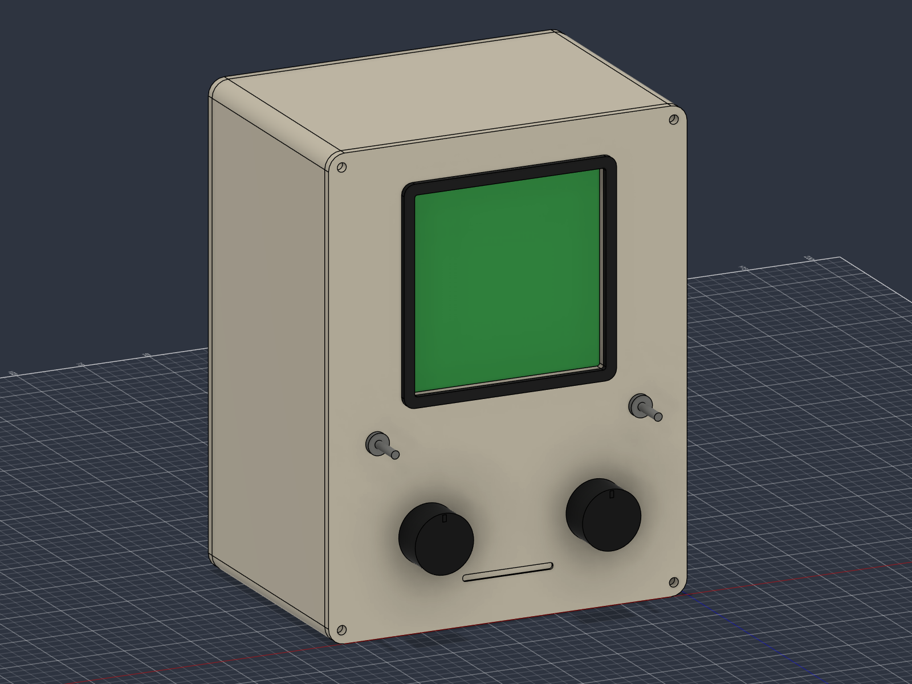

# ORBIT tabletop terminal - revision D rechargeable

A Macintosh-inspired 4-inch green-screen terminal with two knobs and two metal toggles, now with a rechargeable battery option. The case remains 135 mm wide x 175 mm high x 95 mm deep; bezel and controls project beyond that envelope.

- [Bill of materials](BOM.md)
- [Assembly and control wiring](ASSEMBLY.md)
- [Battery, charging, runtime and power firmware design](BATTERY.md)
- [Complete Fusion assembly](cad/generated-revd/ORBIT-RevD.f3d)
- [Internal inspection assembly](cad/generated-revd/ORBIT-RevD-inspection.f3d)
- [STEP, eight printable STLs and validation reports](cad/generated-revd/)

## What changed

Revision D adds a protected 3.7 V / 4400 mAh battery reference, a removable charcoal cradle behind the screen, four cradle fixings on the rear cover, a rear momentary power key and a battery cable corridor. A soft strap and insulating pad retain the pack. The cradle mounts to the removable rear panel above the lower control-electronics tray. Its holder and revised rear cover are the only new/revised printed parts; the other six Rev C parts can be reused.

The selected V4 Waveshare ESP32-S3-LCD-4 includes the controller, display and charging circuitry. **The proposed Adafruit 354 pack requires the charger current to be reduced from the V4 schematic's approximately 2 A setting to approximately 0.8 A and verified before charging.** See BATTERY.md for the hardware requirement, connector polarity checks and first build. It is not a firmware setting. Target endurance is 4-6 hours, based on an assumed power budget rather than measurement.

## CAD views and print parts

The main F3D shows the full shell and rear cover. The inspection F3D deliberately hides those two components so the electronics can be viewed. They remain present and printable.

Eight printed parts: ivory front, shell and revised rear; charcoal bezel, control tray, display retainer, USB adapter and battery cradle. Electronics, purchased knobs, power button, pack, foam, straps and cable-route shapes are reference geometry, not printable parts. Manufacturer outlines are used where available, but board thickness, component positions, connectors and mounting details remain simplified.

Fusion reports 574 healthy timeline features and no interference between the new rigid battery/cradle/button envelopes and the existing simplified assembly. Flexible battery cable and soft retention references are excluded from that interference test. Mesh checks are recorded alongside the exports. These checks do not establish physical fit, electrical operation, charging safety, runtime or thermal performance.

The live Fusion document is **ORBIT Desktop Terminal - Rev D rechargeable battery**. Native local archives preserve the editable assembly. `AddBattery.py.txt` and `ExportBattery.py.txt` record the new modelling/export operations; they apply to a copy of the Rev C archive.

## Build and firmware

Use the Bambu P1S with separate ivory and charcoal PLA parts. Start with a 0.4 mm nozzle, 0.2 mm layers, four walls and 15% gyroid; inspect supports in the slicer. All parts fit the bed individually. STL coordinates retain assembly positions: orient each part and drop it onto the bed. Print the battery cradle with its broad backplate on the bed and guards upwards. Smooth pack-facing edges and strap slots.

The current firmware source remains the compiled **Rev A DevKitC/ILI9341 bench starter**. The Waveshare 480x480 display/control port and battery power service are specified but not implemented. The existing backend API and configurable LAN/HTTPS host remain applicable.

Before final printing, confirm the V4 board, display support stack, USB extension flange, controls, power-key bushing and battery lead exits. Bench-test the charger modification, display, controls and battery/USB transitions. Physical fit and temperature checks remain outstanding.

Historical exports are retained in `cad/generated/` (Rev A), `cad/generated-revb/` and `cad/generated-revc/`. Their copied BOMs/assembly notes describe those older USB-powered revisions; use the current documents above for purchasing.
