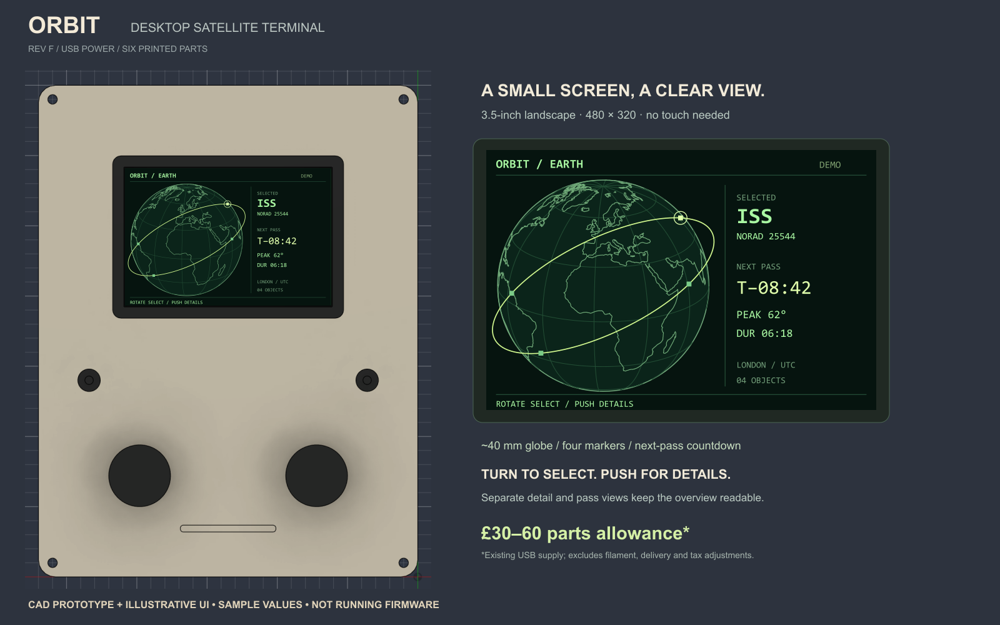
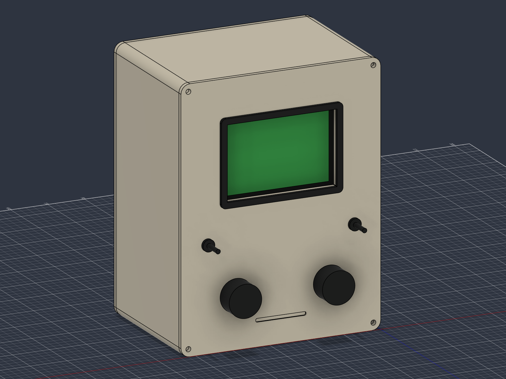

# ORBIT Rev F — affordable USB terminal

**3.5-inch landscape · ESP32-S3 · six printed parts · £30–60 parts allowance**

[AliExpress shopping list](BOM.md) · [Fusion / STEP / STL downloads](cad/generated-revf/) · [Assembly](ASSEMBLY.md) · [UI concept](UI-CONCEPT.md)

The no-touch **MSP3525 / ST7796U** replaces the Adafruit screen. A single USB cable powers/programs the ESP32; no charger or battery is required. The two knobs and two toggles keep the retro controls. The removable display carrier accommodates supplier-specific revisions without replacing the shell.

**Built here:** editable CAD, six printable exports, BOM, power/wiring plan and clearly labelled artwork. **Still to build:** ST7796U firmware, encoder navigation, globe/pass screens and physical validation. The repository's firmware remains the [legacy Adafruit telemetry starter](../firmware/README.md).

CAD checks pass: 413 healthy features, no detected rigid interference, six closed-edge STL meshes within the P1S envelope. Purchased-part fit, temperature and electrical tests remain outstanding. Both enclosure sides remain present; only the separate inspection model hides the shell/rear.

*Budget uses an existing USB supply and excludes filament, delivery and checkout tax adjustments. AliExpress variant prices and UK stock are unverified; every link is marked direct candidate or search in the BOM. Retaining the second knob/toggles and allowing for small-parts packs raises the earlier £25–49 minimum estimate to £30–60.*

The [Rev E rechargeable build](revisions/reve/README.md) remains separate history. Earlier CAD folders and `concept.svg` describe older revisions.
