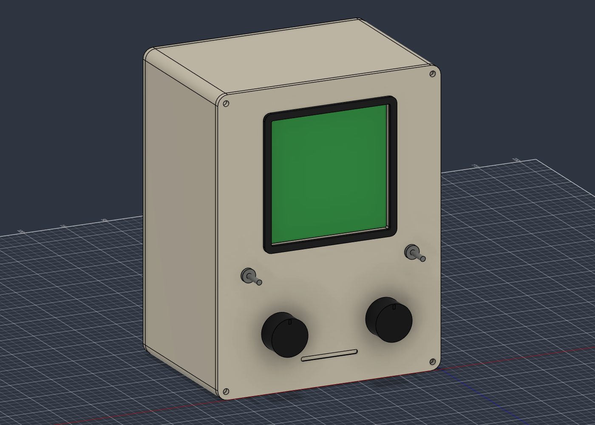

> **Current assembly is revision C with internal electronics and mounting features.** See [build and integration guide](ASSEMBLY.md), [current BOM](BOM.md) and `cad/generated-revc/`. The revision B description below is retained for enclosure dimensions.

Open [ORBIT-RevC.f3d](cad/generated-revc/ORBIT-RevC.f3d) for the complete enclosure with shell and rear visible. [ORBIT-RevC-inspection.f3d](cad/generated-revc/ORBIT-RevC-inspection.f3d) deliberately hides those two bodies to show the electronics; they have not been deleted.

# ORBIT tabletop terminal — revision B / 4-inch

Current design uses **Waveshare ESP32-S3-LCD-4 without touch**, a square 480×480 screen with integrated ESP32-S3. [Bill of materials and wiring](BOM.md). Revision A is retained as historical reference and must not be used for current purchasing.

## Enclosure

135 mm wide × 175 mm high × 95 mm deep for the front/shell/rear assembly; the bezel and controls project from the front. Rounded 6 mm corners, 2.4 mm shell walls, 3 mm removable panels, round M3 screw bosses, rear vents and an oversized USB service opening. Ivory PLA with charcoal bezel/tray. Broad chin, decorative disk recess, two dark knobs and two metal toggles retain the Macintosh-inspired appearance.

Front coordinates in millimetres, X horizontal/Y vertical/Z depth:

| Feature | Revision B |
|---|---|
| Provisional screen aperture | 72×72, X31.5–103.5 / Y85–157 |
| Bezel | 80×80, X27.5–107.5 / Y81–161 |
| Select encoder | Centre (36,36), 7.4 mm bushing clearance |
| Analogue zoom/mask dial | Centre (99,36), 7.4 mm bushing clearance |
| HOLD / GRID toggles | Centres (18,70)/(117,70), 6.4 mm clearance |
| Front/rear screws | Centres (5,5), (130,5), (5,170), (130,170); 3.4 mm bores |
| Electronics tray | Loose 110×85×3 mm plate with mounting slots |

Supplier lists 76.54×74.66 mm for the non-touch module. Its footprint fits the reserved screen area; thickness, connectors, glass offset and fixing holes still need the exact purchased revision's drawing. A hidden reference envelope records this footprint with an explicitly provisional 8 mm depth. The 72 mm aperture is a design estimate for the visible area, not a verified mechanical drawing. Do not clamp glass. Validate clearance and cable exits before finalising its bracket.

## Controls

- Left encoder selects satellite; press cycles orbit, telemetry, passes.
- Right pot controls globe zoom, pass elevation mask 0–30°, or intensity according to page.
- LIVE/HOLD freezes the displayed sample and labels its UTC.
- GRID toggles grid or additional details.

Controls connect through I²C input boards; see BOM. They operate the device UI. Browser synchronisation remains a separate possible API feature.

## CAD and validation

Live Fusion document: **ORBIT Desktop Terminal - Rev B 4-inch**. A new revision was created, preserving revision A. `cad/generated-revb/` contains native F3D, assembly/per-part STEP, five printable STLs, Fusion preview and validation reports. `BuildOrbit.py.txt` records the exact MCP generation source. Original `OrbitTerminal.py` remains the historical revision A generator.

Five printable parts: front, shell, rear cover, bezel, loose electronics tray. Knobs/toggles/screen are hardware reference envelopes, excluded from printable STLs. Fusion confirms one solid per printable component and no timeline health warnings. Mesh checks confirm all STL edges have two adjacent faces and expected millimetre dimensions. This is geometry validation; fit, heat, power and physical operation have not been tested. Local F3D export is available; the cloud document has not been saved.

Still needed before a complete print: exact display fixing bracket, tray attachment to shell, and USB extension adapter. Print a screen/control-hole coupon first. Check bushings span 3 mm panel plus washer/nut; use panel-mount controls. Keep the Wi-Fi antenna clear of metal and wiring.

P1S: 0.4 mm nozzle, 0.2 mm layers, four walls, 15% gyroid with the corresponding PLA profile. Import each STL separately and drop it to the bed: assembly coordinates are retained. Front/rear inside face upwards; shell front rim down/open rear upwards. Inspect support/bridge preview. Every individual part fits the P1S bed. Use separate colour parts without AMS. Keep PLA away from hot sunlight.

## Next steps

1. Buy/confirm the exact non-touch Waveshare board revision and controls; bench-test its stock example and I²C inputs.
2. Port firmware to its RGB display BSP and 480×480 UI; the former ILI9341 starter is incompatible.
3. Finalise screen/tray/USB mounting, print a coupon, then assemble the complete enclosure.
4. Keep the current API; configure LAN address initially and authenticated HTTPS hosting later.

Sources: [Waveshare selection and module footprint](https://www.waveshare.com/product/mcu-tools/esp32-s3-touch-lcd-4.htm), [revision-specific hardware](https://github.com/waveshareteam/ESP32-S3-Touch-LCD-4/blob/main/hardware/HARDWARE_REFERENCE.md).
