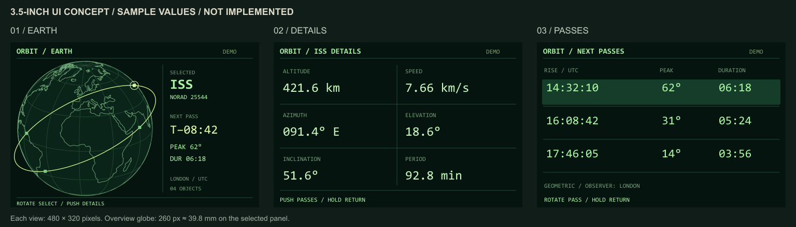

# 3.5-inch screen concept — not implemented firmware

The artwork uses **illustrative values** and has no data connection. At a 73.44×48.96 mm active area, the 260-pixel globe is **39.8 mm across**. A restrained layout keeps the globe, four markers, selected orbit/name and next-pass countdown visible together. Details and passes have separate pages instead of crowding everything onto the map.

| Control / view | Intended behaviour |
| --- | --- |
| SELECT encoder | Rotate through 3–5 visible satellites; click selected item to open details |
| Details | Altitude, speed, azimuth and elevation; local angles only when observer is set |
| Passes | Rise time, maximum elevation and duration; geometric opportunity, not guaranteed optical visibility |
| Push navigation | Short click progresses; hold returns to overview; debounce/UX still to implement |
| HOLD / GRID | Freeze the displayed timestamp / toggle map grid |
| INTENSITY | Backlight control after verifying module LED input |

The existing backend provides catalogue, state, track and pass endpoints. The checked-in embedded source is a **legacy HX8357D telemetry starter**, not this interface. Planned ST7796U driver and input work is listed in [firmware](../firmware/README.md).
