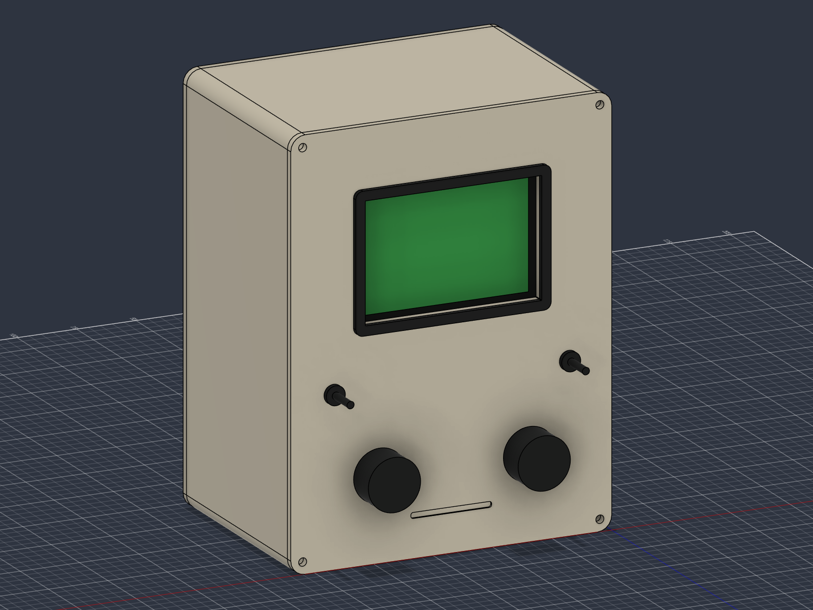
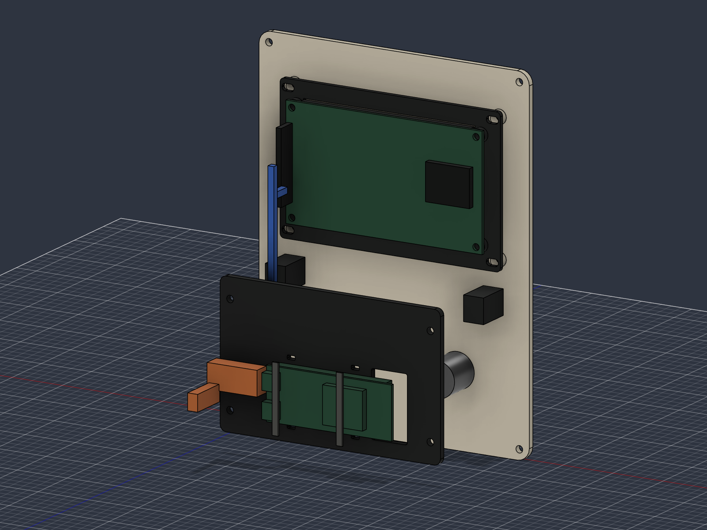

# Rev F — CAD downloads

| Download | Contents |
| --- | --- |
| [Complete Fusion model](ORBIT-RevF.f3d) | Editable as-built model, shell and rear visible |
| [Inspection Fusion model](ORBIT-RevF-inspection.f3d) | Same design with shell/rear hidden |
| [STEP assembly](ORBIT-RevF-assembly.step) | Neutral assembly including reference electronics |
| [Six printable STLs](ORBIT-RevF-print-parts.zip) | Front, shell, rear, bezel, display carrier, ESP32 tray |

Individual numbered STEP/STL files are included. STL units are mm and positions are assembly coordinates: orient and drop parts onto the print bed. Do not print electronics or cable references. See [assembly](../../ASSEMBLY.md) and [BOM](../../BOM.md) before choosing parts or printing.

**Checks:** 413 healthy Fusion timeline entries; six single-solid print parts; zero detected interference across 17 rigid components (26 broad-phase-overlapping pairs analysed). Cable and soft-pad/tie references are excluded. All six STLs have two incident faces per undirected edge and fit the 256 mm P1S envelope. `validation.json`, `interference.json`, `mesh-validation.json` record the checks; these are not self-intersection, physical-fit, electrical or thermal validation.

**Geometry:** the MSP3525 manufacturer specifies 98×55.5 mm PCB and 73.44×48.96 mm active area. A family drawing gives 92×49.5 mm hole pitch; its title references MSP3526, so verify the delivered no-touch board. Reserve 14.3 mm depth with headers. The candidate ESP32 clone, generic controls and USB boot remain fit envelopes. Screen carrier is replaceable, with ±1.3 mm lateral slots; other dimensions require measured shims or regeneration.

`BuildRevF.py.txt` creates a fresh document; `ExportRevF.py.txt` checks/exports the active Rev F design. Rename copies to `.py` for Fusion's script runner or use the local MCP. Set `OUT` to the desired directory. The archive was built in smaller MCP stages; the consolidated generator is syntax-checked, not replayed end-to-end, and has fewer timeline entries than the corrected as-built archive. `CheckMeshes.py.txt` runs from the parent of an `orbit-cad-revf` export folder.
